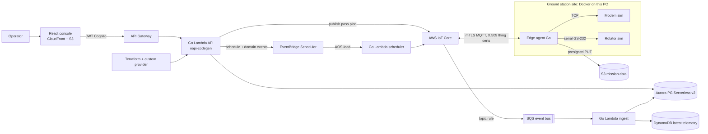

# Ground Station Cloud

[](https://github.com/mini4141/ground-station-cloud/actions/workflows/ci.yml)

Ground segment as a service. Satellite operators book **passes** on a virtual network of ground stations and never deal with antennas or modems.

- **Cloud (Go):** SGP4 pass prediction, conflict-free scheduling, pass plans sent over **MQTT with mutual TLS** (Mosquitto locally, **AWS IoT Core** in AWS), telemetry ingest through an **SQS event bus**, SLA and billing.
- **Edge (Go, Docker):** an agent per station drives a simulated **modem (TCP line protocol)** and **antenna rotator (GS-232 over serial, via `socat`)**, streams 1 Hz telemetry and uploads mission data at loss of signal.
- **Console (TypeScript + React):** pass timeline, booking, live telemetry, SLA monitoring and billing.
- **Fleet as code:** stations are managed with a **custom Terraform provider** (`terraform-provider-groundstation`, plugin framework).

Proof it works: [proof/README.md](proof/README.md). Engineering write-up: [docs/PORTFOLIO.md](docs/PORTFOLIO.md). Progress tracker: [PROGRESS.md](PROGRESS.md).

## Architecture



Locally the same binaries run as plain HTTP services next to Docker Compose stand-ins (Postgres, Mosquitto mTLS, ElasticMQ, DynamoDB Local, Jaeger, Prometheus); `scripts/kind-up.sh` deploys them to **kind** with the Helm chart.

MQTT topics (QoS 1, JSON with `schemaVersion`): `gs/{station}/cmd` (cloud to edge), `telemetry` (1 Hz), `status` (retained heartbeat), `events` (AOS, LOS, lock, errors). Each station certificate is limited to its own topics (Mosquitto ACL locally, IoT policy in AWS).

## Quickstart (local, no AWS calls)

Prerequisites: Go, Node.js + pnpm, Docker, Terraform, OpenSSL (kind, kubectl, Helm optional).

```bash
scripts/dev-up.sh        # certs, compose infra, Go services, 3 agent containers, Terraform stations, seed, console
# console http://localhost:5173  api http://localhost:8080  jaeger http://localhost:16686  prometheus http://localhost:9090
scripts/test-all.sh      # unit, integration, provider acceptance, agent e2e, Playwright, k6 (JUnit/logs in proof/phase1-local/tests)
scripts/kind-up.sh       # optional: Helm chart on kind
scripts/dev-down.sh
```

Demo: sign in (dev OIDC), open **Passes**, click a Tokyo bar and **Book**. Simulated time runs 20x faster (`SIM_TIME_SCALE`), so at AOS minus 5 simulated minutes the plan reaches the Tokyo agent, which slews the rotator, locks the modem and streams telemetry; at LOS the mission file lands in storage and SLA and billing update.

Generated code: `scripts/gen.sh` (oapi-codegen server and client, sqlc, openapi-typescript). CI fails on drift.

## AWS (showcase, ephemeral)

Uses the `ground-station-cloud-deployer` profile in `ap-southeast-2`; everything is created from `infra/` and tagged `Project=ground-station-cloud`, `Ephemeral=true`.

```bash
scripts/deploy.sh                    # images -> ECR, terraform apply, IoT certs, Cognito user, console to S3/CloudFront, stations via the custom provider, agents -> IoT Core
scripts/capture-proof.sh phase2      # Playwright against CloudFront + CLI evidence into proof/phase2-cloud
scripts/destroy.sh && scripts/verify-destroyed.sh
```

No NAT gateways: Lambdas live in private subnets and reach AWS through VPC endpoints; Cognito JWTs are validated by the API Gateway authorizer. Details and cost in [docs/PORTFOLIO.md](docs/PORTFOLIO.md).

## Layout

```
api/openapi.yaml            contract (oapi-codegen -> internal/api)
cmd/{api,ingest,scheduler,devoidc,seed}   services (each also a Lambda)
internal/                   orbit (SGP4), schedule, server, ingest, mqtt, gs232, modemproto, db (goose + sqlc), ...
edge/{agent,sim-modem,sim-rotator}        edge agent and hardware simulators
provider/                   terraform-provider-groundstation
web/console/                React + Vite + Playwright
deploy/                     Lambda/k8s Dockerfile and Helm chart
infra/{aws,stations}        Terraform for AWS and the station fleet
local/                      docker compose (local stack, agents against AWS)
scripts/                    dev-up, test-all, deploy, destroy, capture-proof, ...
data/tle/                   bundled TLE snapshots (no network at runtime)
```
