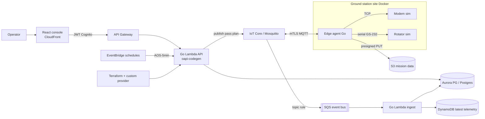

# SPECS.md: Ground Station Cloud

## 1. Summary

A **ground segment as a service** platform. Satellite operators register satellites (TLEs) and book **passes** on a global network of ground stations. They never deal with antennas or modems.

**In the cloud:** Go services compute visibility windows with SGP4, schedule passes without conflicts, and send pass plans over **MQTT** (AWS IoT Core with mutual TLS) to the stations.

**At each station:** a Docker **edge agent**
- points the antenna rotator (serial, GS-232-style) along the predicted track;
- locks the modem (TCP control protocol);
- streams telemetry back at 1 Hz;
- uploads the recorded mission data at loss of signal.

An operator console shows the schedule, live telemetry, SLAs (pass success, latency) and billing (minutes used × rate). The station fleet itself is managed with a **custom Terraform provider**.

**Demo story:**
1. `terraform apply` registers 3 stations: Tokyo, Svalbard and Santiago.
2. The operator adds a CubeSat TLE and sees the upcoming passes.
3. They book one.
4. At AOS (accelerated sim time), the Tokyo agent slews the antenna and locks the modem, and telemetry streams into the console live.
5. At LOS the mission file lands in S3, and the SLA and billing tiles update.

## 2. Requirement coverage matrix

| Requirement | Covered by | Proof |
|---|---|---|
| Virtualise diverse ground station networks on one platform | Stations API + Terraform provider + agents | Console + `terraform apply` log |
| Fast, scalable Go backend (pass scheduling, data distribution, station management) | Go Lambdas: stations, satellites, passes, scheduler, telemetry ingest | Tests |
| MQTT data path for commands, telemetry, mission data | IoT Core/Mosquitto + topics + S3 upload | MQTT logs |
| Service management UI (scheduling, SLA monitoring, billing) | React console | Screenshots |
| Software that talks to modems, antenna drivers, receivers via TCP/IP and serial | Agent drivers + simulators | Agent logs |
| Tools for efficiency, security, reliability, automation | Custom TF provider, mTLS, IoT policies, CI drift checks | CI |
| Design/code reviews, agile | PR template, `docs/adr/` | Repo |
| Linux/Unix, 2+ languages (Go + TS; Python optional) | — | Repo |
| AWS; testing methodologies (unit, integration, acceptance, UI, performance) | All layers incl. a k6 smoke on the passes API | Reports |
| SQL + Git | sqlc/Postgres | — |
| Go production, K8s + serverless (Lambda, API GW, DynamoDB, SQS), MQTT/IoT Core, IaC (Terraform, Docker, CI/CD), drivers (TCP, RS-232), distributed testing, React/TS | All | Proof |
| Orbital mechanics knowledge | SGP4 visibility + az/el tracking | Unit test |
| Dev env: oapi-codegen + sqlc, Lambda container images, IoT Core mTLS, SQS bus, Aurora/PG, DynamoDB, S3, Cognito, CloudFront, EventBridge, custom Terraform provider, Prometheus, OpenTelemetry | All | resources.txt |

## 3. Architecture



## 4. Repository layout

```
api/openapi.yaml
cmd/api/  cmd/ingest/  cmd/scheduler/  cmd/devoidc/        (Go; each also has a Lambda entrypoint)
internal/orbit/  internal/schedule/  internal/db/ (sqlc)  internal/mqtt/
edge/agent/  edge/sim-modem/  edge/sim-rotator/  edge/Dockerfile (agent + socat)
provider/        terraform-provider-groundstation (plugin framework)
web/console/     React + Vite
deploy/helm/     chart for api/ingest/scheduler (kind proof)
infra/           Terraform (AWS) + stations.tf using the custom provider
data/tle/        bundled TLE snapshots
local/           docker-compose.yml (postgres, mosquitto mTLS, elasticmq or moto for SQS, dynamodb-local, jaeger, prometheus)
```

## 5. Features (end-to-end)

### F1: Station management + custom Terraform provider
- API: `POST/GET/PATCH/DELETE /stations` (name, lat, lon, alt, min_elevation, band, rate_per_min).
- The provider implements the `groundstation_station` resource (CRUD + import) and the `groundstation_passes` data source.
- `infra/stations.tf` declares 3 stations.
- **Accept:** `terraform apply` creates them, and `terraform plan` is then clean. The acceptance test passes locally.

### F2: Satellites and pass prediction
- `POST /satellites {name, norad_id, tle1, tle2}`. `GET /passes?satellite=&from=&to=` runs SGP4 per station: AOS, TCA, LOS, max elevation, and the az/el track sampled every 10 s.
- **Accept:** a fixed TLE and a fixed time window give deterministic passes (unit-tested values).

### F3: Booking and scheduling
- `POST /bookings {pass_id}`. The scheduler rejects overlaps on the same station.
- An EventBridge schedule fires at AOS−5 minutes (locally, an in-process ticker using sim time) and publishes the pass plan to `gs/{station}/cmd`.
- **Accept:** booking two overlapping passes on one station gives 409, and the plan message is observed on MQTT.

### F4: Edge agent pass execution
The agent receives the plan, then:
1. Pre-positions the rotator (`W<az> <el>`).
2. Tunes the modem (`FREQ`, `MODE`).
3. At AOS it tracks: sends az/el updates, polls `C2` for the position, polls `LOCK?`.
4. Publishes telemetry frames `{t, az, el, snr, lock, bitrate}`.
5. At LOS, requests a presigned URL (`POST /bookings/{id}/upload-url`), uploads the `mission-<id>.bin` produced by the modem sim, and publishes `events: LOS + upload_ok`.

**Accept:** the agent log shows the full sequence, and the object exists in storage.

### F5: Telemetry ingest + live console
- IoT rule (cloud) or the bridge (local) sends to SQS, then the ingest Lambda, which updates DynamoDB `latest#station` and appends the pass metrics to Postgres.
- The console's live view polls `/stations/{id}/live` every second. Use SSE only if it's simple on API Gateway; otherwise poll.
- **Accept:** the live chart shows SNR and elevation during the pass.

### F6: SLA monitoring + billing
- **SLA:** pass success rate (lock achieved ≥ 80% of the pass), command-to-ack latency p95, and data delivery delay. A table per station and per satellite.
- **Billing:** minutes tracked × station rate, per operator per month.
- **Accept:** both pages update after the demo pass.

### F7: Operator auth
- Cognito Hosted UI (cloud) or the dev OIDC login (local). The API validates the JWT through JWKS, and operators see only their own satellites and bookings.

## 6. Data model

- **Postgres:**
  - `operators(id, name)`
  - `stations(id, name, lat, lon, alt_m, min_el_deg, band, rate_per_min_minor)`
  - `satellites(id, operator_id, name, norad_id, tle1, tle2)`
  - `passes(id, satellite_id, station_id, aos, tca, los, max_el)` (cached predictions)
  - `bookings(id, pass_id, operator_id, status, plan_sent_at, aos_actual, los_actual, lock_ratio, bytes_delivered)`
- **DynamoDB:** `station_live(PK=station_id)` with the latest frame + heartbeat.
- **S3:** `mission/<booking_id>.bin`

## 7. Interfaces

See `api/openapi.yaml`: `/stations`, `/satellites`, `/passes`, `/bookings`, `/bookings/{id}/upload-url`, `/stations/{id}/live`, `/sla`, `/billing`, `/healthz`. MQTT topics are listed in CLAUDE.md §11.

## 8. Test plan

See CLAUDE.md §7. Also a k6 smoke: `GET /passes` at 20 rps for 30 s, p95 < 500 ms.

## 9. Phase 1: Local

`scripts/dev-up.sh`:
1. Generate the mTLS certs.
2. Compose up: postgres, mosquitto (mTLS), SQS emulator, dynamodb-local, jaeger, prometheus.
3. Run the Go services as HTTP servers.
4. Start the console.
5. Start 3 agent containers.
6. `terraform apply` the stations with the dev provider.

`scripts/kind-up.sh` also deploys api/ingest/scheduler to kind with the Helm chart (proof of K8s packaging).

- [ ] `tests/`: go unit/integration JUnit, provider acceptance log, agent e2e log, Playwright report, k6 summary
- [ ] `screenshots/01-stations-map.png`, `02-passes-timeline.png`, `03-booking.png`, `04-live-telemetry.png`, `05-sla.png`, `06-billing.png`, `07-jaeger-trace.png`
- [ ] `logs/terraform-provider-apply.log`, `logs/mqtt-sub-all.log` (`mosquitto_sub -t 'gs/#'`), `logs/agent-pass-tokyo.log` (serial + TCP exchanges), `logs/kind-get-all.txt`

## 10. Phase 2: AWS

| Local | AWS |
|---|---|
| Go HTTP servers / kind | Lambda container images (ECR) + API Gateway HTTP API |
| Mosquitto mTLS | IoT Core (things, certs, policies, topic rule → SQS) |
| SQS emulator | SQS (+ DLQ) |
| Postgres | Aurora PostgreSQL Serverless v2 in private subnets. The Lambdas run in the same private subnets with **no NAT**. They reach AWS services through VPC endpoints: gateway endpoints for S3 and DynamoDB (free), and single-AZ interface endpoints for SQS, IoT Data, EventBridge Scheduler and X-Ray. Cognito JWTs are validated by the **API Gateway JWT authorizer**, so the Lambdas never need internet access to fetch JWKS. Record this in DECISIONS.md |
| dynamodb-local | DynamoDB |
| local folder | S3 mission bucket |
| dev OIDC | Cognito user pool + app client (+ Hosted UI domain prefix) |
| in-process ticker | EventBridge Scheduler (one-time schedule per booking) |
| Jaeger | ADOT Lambda layer → X-Ray |
| Vite dev | S3 + CloudFront |

`scripts/deploy.sh`:
1. Build and push the Lambda images.
2. `terraform apply` (infra).
3. Write the IoT certs to `.local/certs/aws/`.
4. `terraform apply` the stations through the custom provider against the API Gateway URL.
5. Start the local agents pointed at the IoT endpoint.
6. Create a Cognito test user.
7. Run Playwright against CloudFront.

- [ ] `screenshots/01-cf-passes.png`, `02-cf-live-telemetry.png`, `03-cf-sla.png`, `04-cf-billing.png`
- [ ] `logs/iot-describe-endpoint.txt`, `logs/iot-mqtt-test-client.log` (agent connect + publish), `logs/sqs-ingest-lambda.log`, `logs/eventbridge-schedule.json`, `logs/s3-mission-object.json`, `logs/xray-trace-summary.json`, `resources.txt`

## 11. Phase 3: Destroy

`destroy.sh`:
1. Stop the agents.
2. `terraform destroy` the stations, then the infra (the IoT certs must be detached and inactive first; handle that in the script).
3. Empty the buckets.

`verify-destroyed.sh` checks for no IoT things or certs, Lambdas, API Gateway API, Aurora cluster, DynamoDB tables, SQS queues, Cognito user pool, CloudFront distribution or EventBridge schedules.

## 12. Out of scope

Real RF, GNU Radio flowgraphs, licensing workflows, a real vendor modem API, and multi-region.
