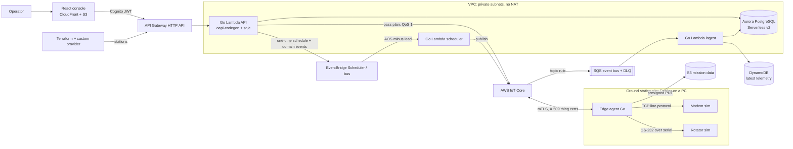
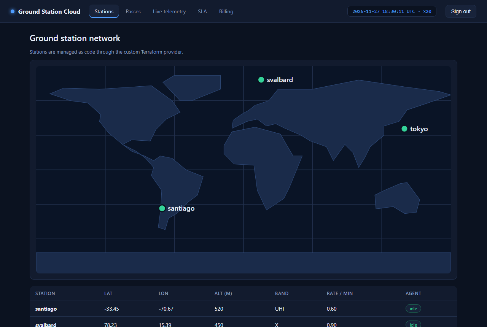
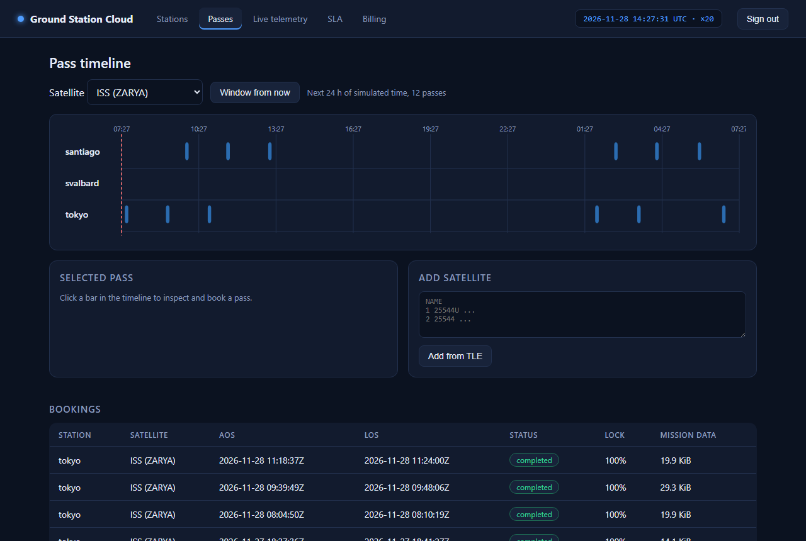
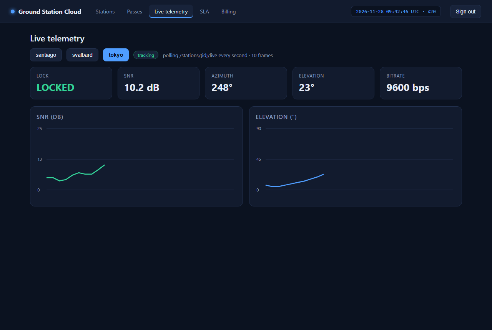
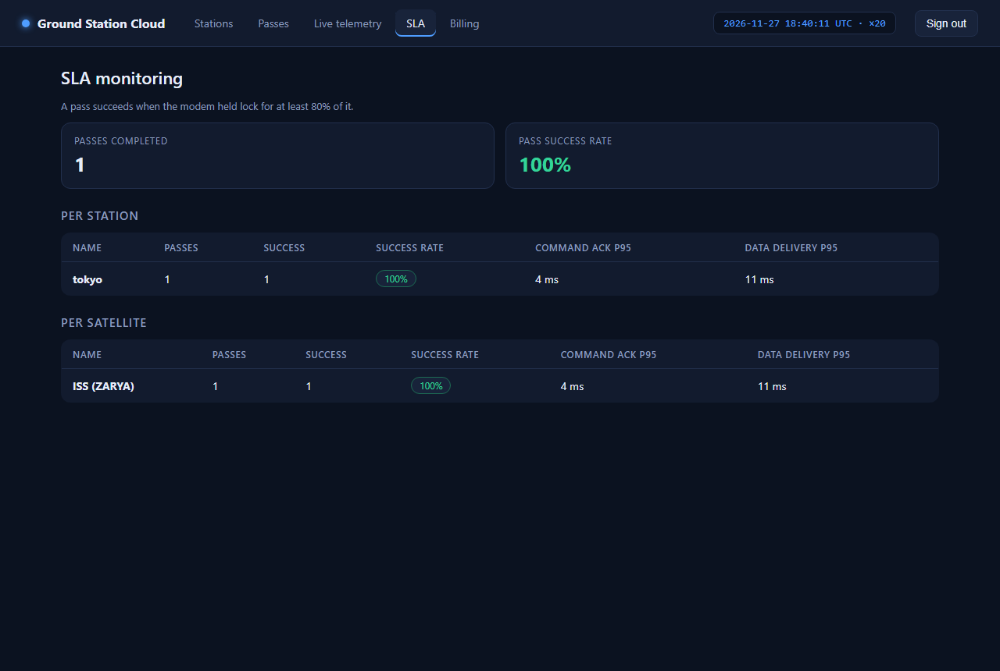
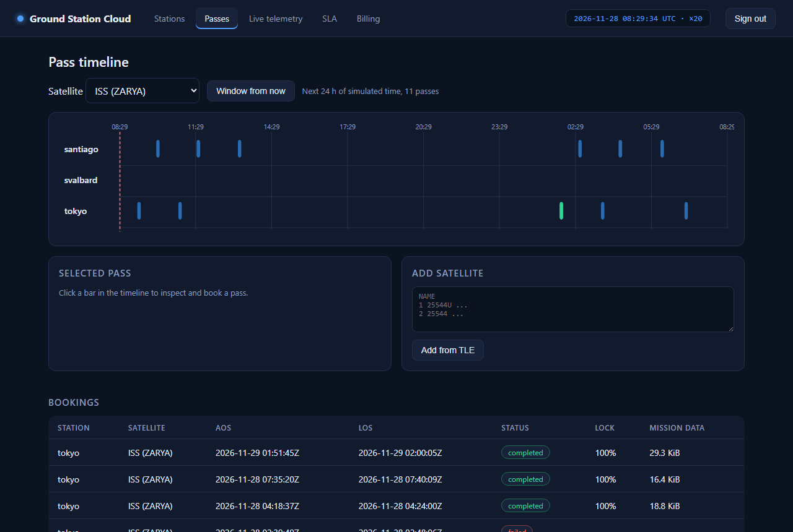
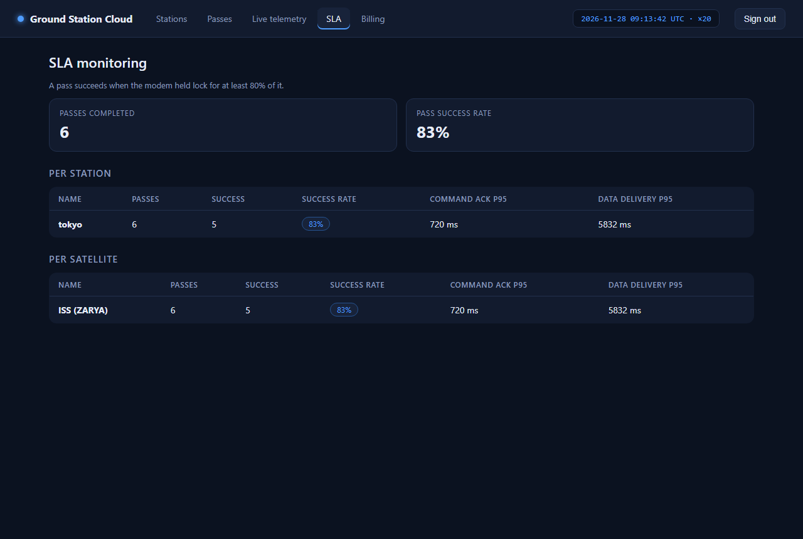
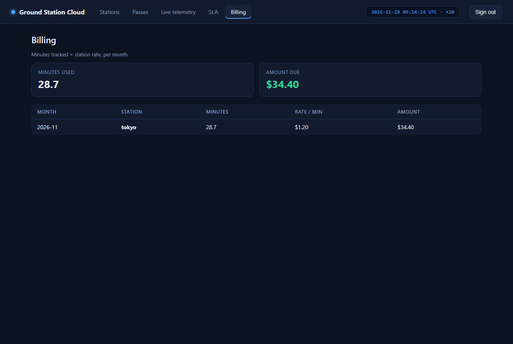

# Ground Station Cloud: ground segment as a service

> Technical write-up of a portfolio project: a platform that connects satellite ground stations to the cloud over MQTT, built end to end (Go, MQTT/IoT, AWS serverless, React, Terraform) and proven on a real AWS deployment that was destroyed afterwards.

## The problem

Satellite operators need contact time with ground stations, but every station has its own modems, rotators and control interfaces, and booking contacts is manual. A ground-segment-as-a-service platform hides that: operators register a satellite (TLE), see when it is visible from each station, book a pass, and the platform does the rest. At the station, a small agent turns a cloud-side pass plan into hardware commands and sends telemetry and mission data back.

What this project builds:

1. **Pass prediction and scheduling (Go).** SGP4 propagation from bundled TLE snapshots gives AOS, TCA, LOS, maximum elevation and a 10-second az/el track per station. The scheduler refuses overlapping bookings on one station under a per-station advisory lock.
2. **A secure data path.** Pass plans travel to the station over MQTT with mutual TLS (Mosquitto locally, AWS IoT Core in AWS). Each station certificate may only touch its own `gs/{station}/...` topics. Telemetry returns through an IoT topic rule into SQS and a Go Lambda that updates DynamoDB (latest frame) and Aurora (pass metrics).
3. **An edge agent that does not know it is talking to simulators.** The agent drives a modem over a vendor-style TCP line protocol (`FREQ`, `MODE`, `LOCK?`, `DUMP`) and an antenna rotator over serial with GS-232 commands (`Waaa eee`, `C2`) through a `socat` virtual serial pair. Signal quality in the modem simulator follows the real antenna pointing, so a lagging rotator shows up as a worse SNR.
4. **An operator console (TypeScript + React):** pass timeline with booking, live telemetry, SLA monitoring (pass success, command-ack and delivery latency p95) and billing (minutes tracked x station rate).
5. **Fleet as code.** The station fleet is managed with a custom Terraform provider (`terraform-provider-groundstation`, plugin framework) that talks to the platform API through the generated OpenAPI client.

## Architecture



Local development uses the same binaries as plain HTTP services next to Docker Compose stand-ins (Postgres, Mosquitto with mTLS, ElasticMQ, DynamoDB Local, Jaeger, Prometheus), and `scripts/kind-up.sh` installs them on kind with a Helm chart.

## Stack to requirement table

| Area | Technology | Where it shows up | Proof |
|---|---|---|---|
| Backend | Go; REST/OpenAPI 3 with oapi-codegen (server + client); sqlc + pgx; goose; slog | `api/openapi.yaml`, `internal/api`, `internal/db`, `cmd/*` | [go-unit](../proof/phase1-local/tests/go-unit.log), [go-integration](../proof/phase1-local/tests/go-integration.log) |
| Orbital mechanics | SGP4 (`go-satellite`) with fixed TLE and window | `internal/orbit` | golden-value unit test, [Gantt screenshot](../proof/phase1-local/screenshots/02-passes-timeline.png) |
| Compute | AWS Lambda container images + API Gateway; same code as HTTP server; Helm + kind | `deploy/`, `infra/aws/compute.tf` | [lambda-functions.json](../proof/phase2-cloud/logs/lambda-functions.json), [kind-get-all.txt](../proof/phase1-local/logs/kind-get-all.txt) |
| Messaging | MQTT mTLS: Mosquitto locally, AWS IoT Core (X.509 certs, IoT policies, topic rule) in AWS | `internal/mqtt`, `infra/aws/iot.tf` | [mqtt-sub-all.log](../proof/phase1-local/logs/mqtt-sub-all.log), [iot-describe-endpoint.txt](../proof/phase2-cloud/logs/iot-describe-endpoint.txt), [iot-station-policies.json](../proof/phase2-cloud/logs/iot-station-policies.json), [iot-topic-rule.json](../proof/phase2-cloud/logs/iot-topic-rule.json) |
| Event bus | SQS (+ DLQ) feeding the ingest Lambda; EventBridge Scheduler for pass reminders; EventBridge domain events | `internal/ingest`, `internal/events` | [sqs-ingest-lambda.log](../proof/phase2-cloud/logs/sqs-ingest-lambda.log), [eventbridge-schedule.json](../proof/phase2-cloud/logs/eventbridge-schedule.json) |
| Data | PostgreSQL 17 locally, Aurora PostgreSQL Serverless v2 in AWS; DynamoDB; S3 | `internal/db`, `internal/live`, `internal/storage` | [aurora-cluster.json](../proof/phase2-cloud/logs/aurora-cluster.json), [dynamodb-station-live.json](../proof/phase2-cloud/logs/dynamodb-station-live.json), [s3-mission-object.json](../proof/phase2-cloud/logs/s3-mission-object.json) |
| Auth | Cognito user pool + API Gateway JWT authorizer; local dev OIDC with the same claims | `infra/aws/cognito.tf`, `cmd/devoidc`, `internal/auth` | [cognito-user-pool.json](../proof/phase2-cloud/logs/cognito-user-pool.json) |
| Ground segment | Docker edge agent; modem over TCP; rotator over serial (socat pty pair, TCP fallback flag) | `edge/`, `internal/gs232`, `internal/modemproto` | [agent-pass-tokyo.log](../proof/phase1-local/logs/agent-pass-tokyo.log) |
| Frontend | TypeScript + React + Vite; S3 + CloudFront | `web/console`, `infra/aws/web.tf` | [local screenshots](../proof/phase1-local/screenshots), [cloud screenshots](../proof/phase2-cloud/screenshots) |
| Observability | Prometheus metrics; OpenTelemetry to Jaeger locally and to X-Ray through the ADOT collector in AWS | `internal/platform`, `internal/server/handler.go` | [Jaeger trace](../proof/phase1-local/screenshots/07-jaeger-trace.png), [xray-trace-summary.json](../proof/phase2-cloud/logs/xray-trace-summary.json) |
| IaC | Terraform, including a custom provider (`groundstation_station` resource, `groundstation_passes` data source) | `infra/`, `provider/` | [apply log](../proof/phase1-local/logs/terraform-provider-apply.log), [clean plan](../proof/phase1-local/logs/terraform-provider-plan-clean.log), [acceptance test](../proof/phase1-local/tests/provider-acceptance.log) |
| CI/CD | GitHub Actions: codegen drift checks, build, Terraform validate, Helm lint, every cloud-free test layer | `.github/workflows/ci.yml` | green runs on `main` |
| Testing | Unit, integration, provider acceptance, agent e2e, Playwright UI, k6 performance | `scripts/test-all.sh` | [tests folder](../proof/phase1-local/tests), [k6 summary](../proof/phase1-local/tests/k6-summary.txt) |

## Key screenshots

Local stack (real data through Mosquitto mTLS, the agents and the Go services):

| | |
|---|---|
|  |  |
|  |  |

AWS (CloudFront, API Gateway, Lambda, IoT Core, SQS, Aurora, DynamoDB, S3), driven by the same Playwright flow:

| | |
|---|---|
|  |  |
|  |  |

Trace of `GET /passes` with its SQL spans in Jaeger: [07-jaeger-trace.png](../proof/phase1-local/screenshots/07-jaeger-trace.png). Lambda invocations rendered from the CLI: [05-cw-lambda-invocations.png](../proof/phase2-cloud/screenshots/05-cw-lambda-invocations.png). Everything was destroyed afterwards: [verify-destroyed.txt](../proof/phase3-destroy/verify-destroyed.txt).

## What was hard

- **No NAT, still serverless.** The Lambdas sit in private subnets next to Aurora and reach AWS only through VPC endpoints (gateway for S3 and DynamoDB, single-AZ interface endpoints for SQS, IoT data, Scheduler, EventBridge and X-Ray). Two consequences: Cognito JWTs are verified by the API Gateway authorizer (the Lambda has no route to fetch JWKS), and the IoT data service turned out to have no private DNS name, so the publisher dials the endpoint's `vpce` DNS name while TLS and SigV4 keep the real IoT host.
- **IoT Core details that only fail at runtime.** The agent's retained heartbeat and last-will need `iot:RetainPublish`, otherwise the broker silently drops the connection and the client just looks like it timed out.
- **CORS with a JWT-protected `$default` route.** API Gateway cannot answer preflights for routes behind an authorizer, so the Lambda answers CORS itself behind an unauthenticated `OPTIONS` route.
- **Lambda container images cannot use layers**, so the ADOT collector layer is downloaded at deploy time and baked into the image; traces then reach X-Ray from the same Go OpenTelemetry code that feeds Jaeger locally.
- **Simulated time.** Passes last minutes, demos must not. A shared simulated clock (one Postgres row, carried inside each plan as `simNow`/`simScale`) lets a 10-minute pass run in about 30 seconds, while the agent, scheduler and console agree on "now". EventBridge schedules are created for the real instant that corresponds to AOS minus the lead time.
- **A bursty live view in the cloud.** SQS event source mappings deliver telemetry in small batches and DynamoDB keeps only the latest frame, so the browser sees a new frame about every 3 seconds in AWS (every second locally). All frames still reach Aurora for the lock ratio. A stale-frame bug (the last frame of the previous pass looked live) was found by the cloud run and fixed by showing frames only while the station state is `tracking`.
- **Windows host, Linux targets.** Everything runs from Git Bash on Windows with POSIX scripts; path conversion for native tools, executable bits in git and a platform-dependent embedded OpenAPI blob (which tripped the generated-code drift check) were the sharp edges.

## Approximate AWS cost

The stack lived for roughly 1.5 hours in `ap-southeast-2`. Estimated spend is **under US$2** (Aurora Serverless v2 at 0 to 1 ACU, five single-AZ interface endpoints, and pay-per-use Lambda, API Gateway, IoT Core, SQS, DynamoDB, S3, CloudFront, ECR and X-Ray at demo volumes). This is an estimate from the resource mix and runtime, not a billing figure. Cost guardrails in the code: no NAT gateways, no multi-AZ, Aurora min 0 ACU with auto-pause, 1-day log retention, force-destroyable buckets and repositories, and a destroy script plus a verification script that fails if anything tagged `Project=ground-station-cloud` remains.

## How to reproduce

```bash
# local: no AWS calls
scripts/dev-up.sh && scripts/test-all.sh && scripts/capture-proof.sh phase1

# AWS (profile ground-station-cloud-deployer, ap-southeast-2)
scripts/deploy.sh && scripts/capture-proof.sh phase2
scripts/destroy.sh && scripts/verify-destroyed.sh
```

Prerequisites: Go, Node.js + pnpm, Docker (with BuildKit), Terraform, OpenSSL, AWS CLI v2; kind, kubectl and Helm for the Kubernetes proof.

## Extension path: RF and GNU Radio

RF work (SDR front ends, GNU Radio flowgraphs, spectrum analysis) is deliberately out of scope here. The extension point is the agent's driver layer: `Modem` and `Rotator` are small interfaces, and the agent never learns whether a TCP endpoint is a simulator or a receiver. A GNU Radio flowgraph would sit behind the `Modem` interface (a control port for frequency and mode, a status query for lock and SNR, a recording that `Dump` returns), exactly like the simulated modem does today, with no change to the cloud contract.
